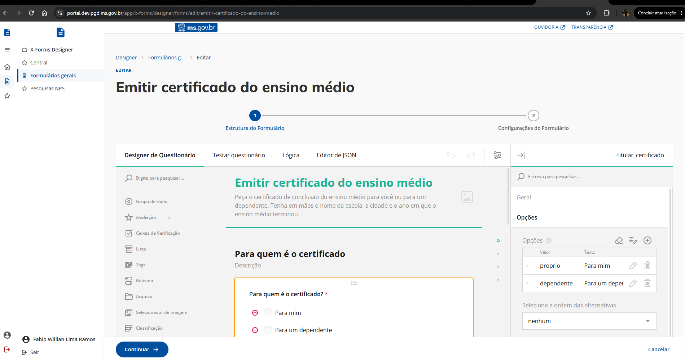
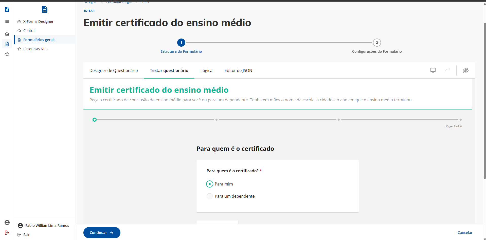
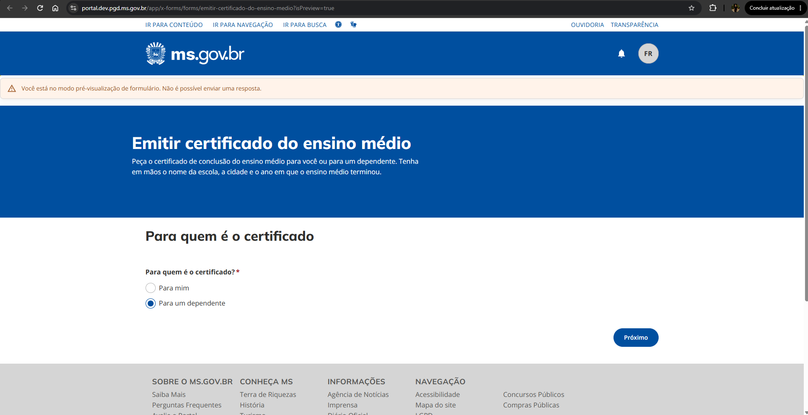
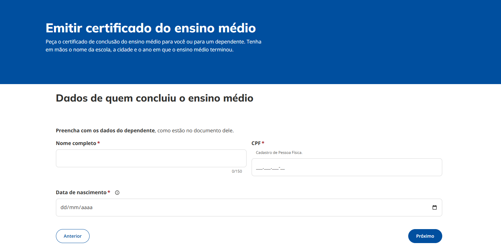

# Formulário: o que o cidadão vê

**O mesmo formulário aparece de 3 jeitos no X-Forms, e só o terceiro é o que o cidadão vê.** Quem monta o formulário
confere no Designer ou no "Testar questionário" e publica algo diferente do que viu.

Exemplo: o formulário *Emitir certificado do ensino médio*, em desenvolvimento (23/11/2026).

## As 3 telas

<figure>
  
  <figcaption><b>1. Designer (canvas).</b> Onde o formulário é montado. Mostra os campos em outro layout, com os controles de edição.</figcaption>
</figure>

<figure>
  
  <figcaption><b>2. Testar questionário.</b> Roda o SurveyJS puro: outro tema, outra barra de etapas, outro radio. <b>Não é o que o cidadão vê.</b></figcaption>
</figure>

<figure>
  
  <figcaption><b>3. Visualizar (portal).</b> É a tela do cidadão, com a cara do ms.gov.br. Foi feita pela X-VIA e <b>ainda não foi validada</b>.</figcaption>
</figure>

<figure>
  
  <figcaption><b>3. Visualizar, passo 2.</b> Nome completo e CPF lado a lado, desalinhados: a ajuda "Cadastro de Pessoa Física" fica entre o rótulo e o campo e empurra o CPF para baixo. O contador 0/150 fica solto embaixo do Nome.</figcaption>
</figure>

## O que encontramos

| # | Achado | Onde | Efeito |
|---|---|---|---|
| 1 | O Testar questionário não mostra a tela do cidadão: tema, cabeçalho, barra de etapas, radio e botões são outros | Tela 2 × tela 3 | Quem monta valida a tela errada e só descobre o problema depois de publicar |
| 2 | O canvas do Designer mostra um terceiro layout | Tela 1 | Mais uma versão para conferir; nenhuma bate com a do cidadão |
| 3 | Campos lado a lado desalinhados: a ajuda fica entre o rótulo e o campo, e o contador desce | Tela 3, passo 2 | Formulário com cara de improviso, e mais difícil de ler |
| 4 | O Visualizar nunca passou por homologação visual da SGD | Tela 3 | Os erros chegam ao cidadão sem ninguém ter conferido |

## O Design System já tem os componentes?

Quase todos. A fonte é o `@plataforma-xvia/ds-react` (0.14.4) e o `llms.txt` dele.

| Componente | No DS MS | Observação |
|---|---|---|
| Texto curto, CPF, e-mail, telefone | `ds-input` | Rótulo em cima, **ajuda abaixo do campo**, que vira mensagem de erro |
| Texto longo com contador | `ds-textarea` | `maxlength` liga o contador "atual/máximo" |
| Data | `ds-input type="date"` | O próprio DS manda usar este, não o calendário |
| Opção única | `ds-radio` | **Falta o grupo**: o `fieldset` com `legend` é da aplicação |
| Várias opções | `ds-checkbox` | **Falta o grupo**, como no radio |
| Lista | `ds-select`, `ds-combobox` | — |
| Arquivo | `ds-file-drop` | Formato e tamanho na linha de ajuda |
| Etapas | `ds-stepper` | O X-Forms usa a barra do SurveyJS |
| Resumo de erros no topo | `ds-alert` | — |
| **Máscara** (CPF, CEP, telefone) | **Não tem** | Vem do X-Forms (`inputMask`) |
| **Colunas e largura por conteúdo** | **Não tem** | Todo campo ocupa 100%; não há componente de layout de formulário |

## O que pedimos à X-VIA

1. **Uma só renderização.** O "Testar questionário" usa o mesmo renderizador do portal. Se der, o canvas também.
2. **O Visualizar segue o DS MS:**
    - a ajuda fica abaixo do campo, como no `ds-input`, nunca entre o rótulo e o campo;
    - o contador fica alinhado ao campo dele;
    - um campo por linha; se houver colunas, os campos alinham pelo topo do campo, não pelo rótulo;
    - radio e checkbox em grupo, com `fieldset` e `legend`;
    - etapas no padrão do `ds-stepper`.
3. **Homologação visual pela SGD** antes de publicar formulário novo: a SGD confere no Visualizar e dá o aceite.

## O que é com a SGD

- A regra de layout do [padrão de formulário](formulario.md): um campo por linha e ajuda abaixo do campo.
- A [homologação](homologacao.md) confere sempre no Visualizar, nunca no Testar questionário.
