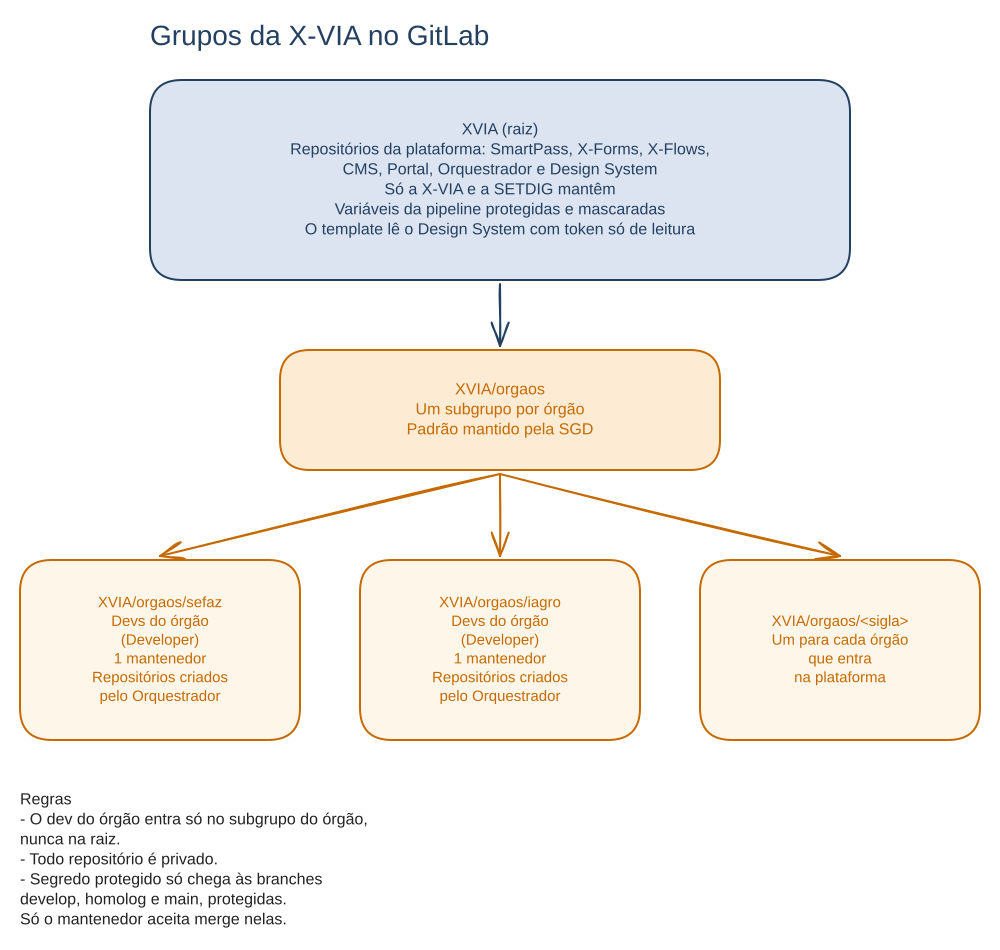
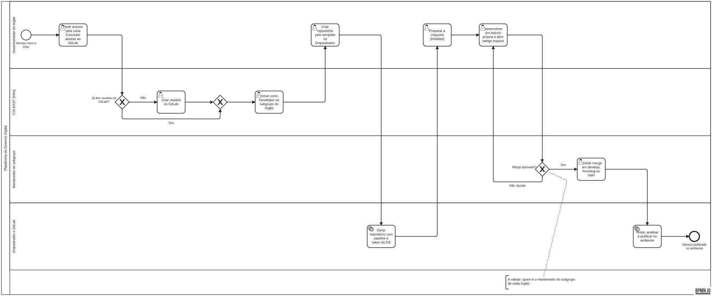

# Governança do Orquestrador e do Design System

Regras de acesso ao GitLab, ao Orquestrador e ao Design System para quem desenvolve um serviço para um órgão.
Validadas com a X-VIA (Victor Carnaval) em 25/11/2026. **Esta página é a versão oficial.**

!!! tip "Quer ver em slides?"
    [Abra a apresentação da governança](apresentacao/governanca/index.html){ target=_blank }.

## 1. Por que existe esta regra?

Quem entra como Guest no grupo raiz `XVIA` do GitLab vê todos os repositórios da X-VIA. Esta regra dá acesso a quem
desenvolve para um órgão **sem expor o código e os segredos da plataforma**.

## 2. Como os grupos estão organizados?

Clique na figura para ampliar.

{ target=_blank }

| Grupo | O que tem | Quem entra |
|---|---|---|
| `XVIA` (raiz) | Repositórios da plataforma: SmartPass, X-Forms, X-Flows, CMS, Portal, Orquestrador e Design System. Variáveis da pipeline, protegidas e mascaradas | Só a X-VIA e a SETDIG |
| `XVIA/orgaos` | Um subgrupo por órgão. Padrão mantido pela SGD | — |
| `XVIA/orgaos/<sigla>` | Repositórios criados pelo Orquestrador para aquele órgão | Devs do órgão como **Developer** e um mantenedor |

O Design System chega ao repositório do órgão por um **token só de leitura** (`read_package_registry`) que já vem no
template do Orquestrador. Ninguém do órgão entra como Guest ou Reporter para usar o Design System.

## 3. Como consigo acesso?

1. Peça pela carta de serviço
   [Conceder acesso ao GitLab](https://www.ms.gov.br/ciencia-e-tecnologia/conceder-acesso-ao-gitlabs17), do seu e-mail
   institucional, com nome, equipe e órgão. A CSI-EAST, equipe de infraestrutura, atende em até 2 dias úteis.
2. No primeiro acesso, crie a sua própria senha do GitLab. Ele só abre na rede do Governo ou pela VPN.
3. A CSI-EAST põe você como Developer no subgrupo do seu órgão, por exemplo `XVIA/orgaos/sefaz`.

Não existe carta separada para o Design System: a de acesso ao GitLab cobre os dois.

## 4. Como crio e publico o meu serviço?

{ target=_blank }

1. Entre no Orquestrador com o login do GitLab e escolha o template: **Frontend Next.js** (tela no portal) ou
   **Backend NestJS** (API). Use um nome de repositório que nenhum outro órgão use. O repositório nasce privado, com a
   pipeline e o Design System prontos.
2. Depois de clonar, rode `node scripts/initialize.mjs` para preparar a sua máquina.
3. Trabalhe numa branch sua e abra merge request. A `develop` publica em desenvolvimento, a `homolog` em homologação e
   a `main` em produção. O mantenedor do subgrupo aceita o merge.
4. A pipeline testa, analisa o código, publica e registra o microfrontend no CMS sozinha.
5. A tela só aparece no portal quando o **Administrador do CMS** liga a carta de serviço a ela. A carta precisa ter
   uma etapa digital. Nessa etapa, ele marca o serviço como interno e escolhe o microfrontend. O CMS não publica a
   carta antes de o microfrontend estar publicado, e sem carta vigente ligada a ele o microfrontend sai do portal.

O passo a passo completo do serviço, com requisitos e homologação, está em [Orquestrador](orquestrador.md).

## 5. O que eu não posso fazer?

- Entrar na raiz `XVIA` ou no subgrupo de outro órgão.
- Criar repositório **Internal**. Com essa opção, qualquer pessoa logada no GitLab do Estado vê o código. Use sempre
  privado.
- Fazer merge direto em `develop`, `homolog` ou `main`. Só o mantenedor do subgrupo faz.
- Ver ou cadastrar os segredos da pipeline. Quem cuida deles é a X-VIA.

## 6. Quem eu procuro?

| Preciso de | Procure |
|---|---|
| Usuário no GitLab ou acesso ao subgrupo | CSI-EAST (Caio), pela carta de serviço |
| Aceite de merge | Mantenedor do subgrupo do órgão |
| Orquestrador, template ou pipeline | X-VIA (Victor Carnaval) |
| Componentes do Design System | UCQI (Thereza e Bruno) |
| Dúvida sobre esta regra | SGD (SETDIG) |

Quando alguém sai da equipe, o órgão avisa a CSI-EAST para retirar o acesso.

!!! note "Figuras editáveis"
    O fluxo (BPMN) e os grupos (Excalidraw) ficam no Drive da SGD, ao lado do documento de origem
    [Governança do Orquestrador e do acesso ao Design System](https://docs.google.com/document/d/1kSKsbJ3RTFWfbVw4Ix550Z_S72pQz7PNl-xmdzMnqw0/edit).
