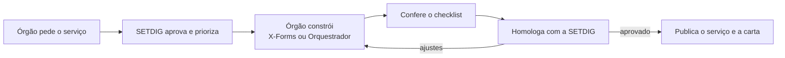

# O padrão em uma tela

Todo serviço que entra na Plataforma de Governo Digital de MS segue o mesmo padrão. Assim o cidadão sente que está
no mesmo sistema, da carta de serviço até o fim do pedido.

**Serviço é, no fundo, um formulário.** Por isso o padrão começa pelo formulário e pelas duas ferramentas onde ele é
construído: o **X-Forms** (o órgão monta na tela) e o **Orquestrador** (a TI do órgão programa).

!!! tip "Quer ver o resumo visual?"
    [Abra a página da governança](apresentacao/index.html){ target=_blank }.

## O caminho do serviço

## Os 7 requisitos

| # | Todo serviço… | Detalhe |
|---|---|---|
| 1 | usa os **dados mestres** | [Checklist](checklist.md#1-usa-os-dados-mestres) |
| 2 | aproveita os **recursos do celular** quando precisa | [Checklist](checklist.md#2-aproveita-os-recursos-do-celular) |
| 3 | termina com a **Avaliação de Serviços** | [Checklist](checklist.md#3-termina-com-a-avaliacao-de-servicos) |
| 4 | mostra o **status na Minha área** | [Checklist](checklist.md#4-mostra-o-status-na-minha-area) |
| 5 | permite o **serviço proativo** (avisa antes de o cidadão pedir) | [Checklist](checklist.md#5-permite-o-servico-proativo) |
| 6 | **protege os campos** | [Checklist](checklist.md#6-protege-os-campos) |
| 7 | passa pela **homologação com a SETDIG** | [Homologação](homologacao.md) |

E o formulário segue o [padrão de formulário](formulario.md).

## Por onde começar

- Vai montar no **X-Forms**? Leia [X-Forms](xforms.md).
- Vai programar no **Orquestrador**? Leia [Orquestrador](orquestrador.md).
- Qual componente usar? Veja [Componentes do formulário](componentes.md).
- Terminou? Confira o [checklist](checklist.md) e peça a [homologação](homologacao.md).
